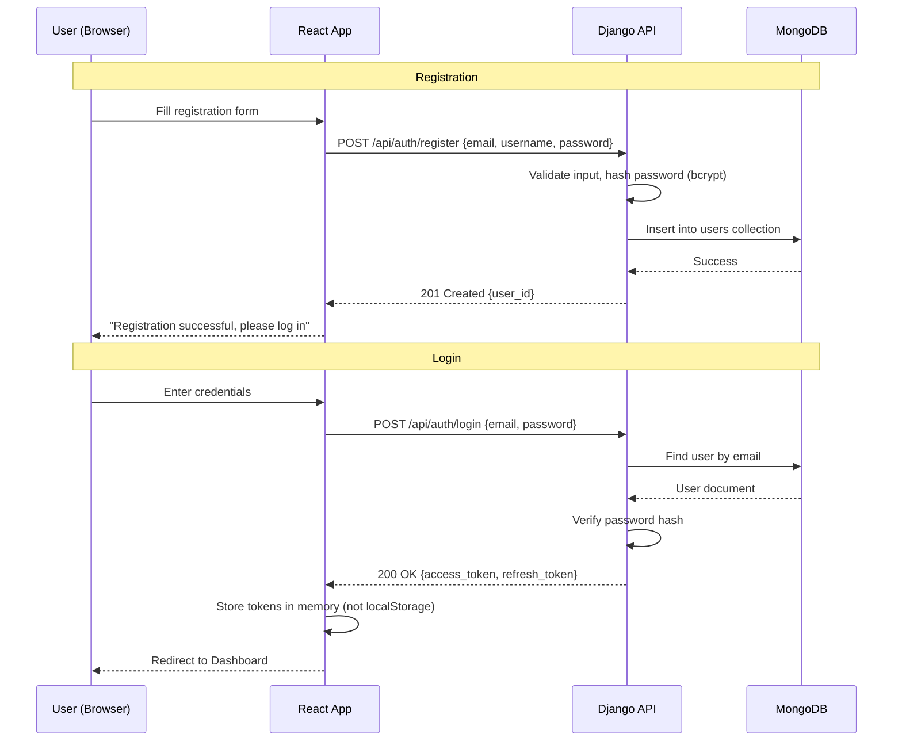
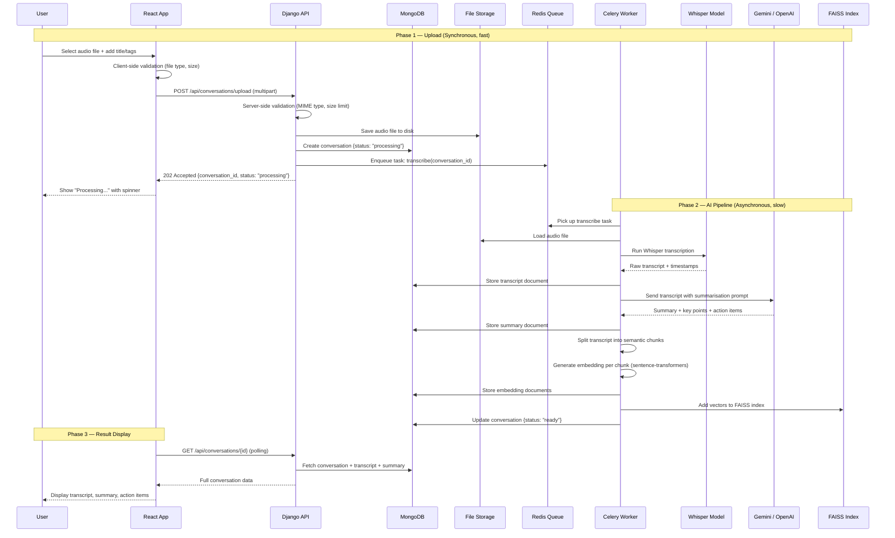
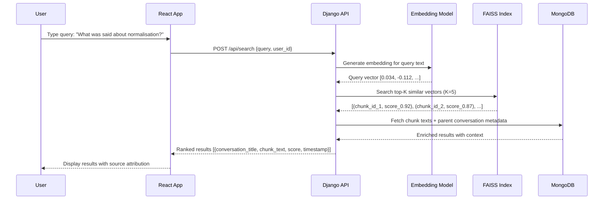

# Kairo — System Architecture

> Architecture document for **Kairo: AI Conversational Memory Assistant**
> Companion to [project-context.md](file:///Users/mohammed/kairo/docs/project-context.md)

**Last updated:** 2026-06-04
**Author:** Mohammed Kutubudin Kapasi

---

## 1. High-Level Architecture

Kairo follows a **layered architecture** with clear separation between presentation, application logic, AI processing, and data storage. The system is designed around an **asynchronous processing pipeline** — because audio transcription and AI analysis are long-running operations that must not block the user's experience.

### System Overview Diagram

```
┌─────────────────────────────────────────────────────────────────────────┐
│                          CLIENT LAYER                                   │
│                                                                         │
│   ┌───────────────────────────────────────────────────────────────┐     │
│   │                     React.js SPA (Browser)                    │     │
│   │                                                               │     │
│   │   ┌──────────┐ ┌──────────┐ ┌──────────┐ ┌──────────────┐   │     │
│   │   │  Auth    │ │  Upload  │ │Dashboard │ │   Search /   │   │     │
│   │   │  Pages   │ │  Flow    │ │  & List  │ │   Chat UI    │   │     │
│   │   └──────────┘ └──────────┘ └──────────┘ └──────────────┘   │     │
│   │                                                               │     │
│   │   ┌──────────────────┐  ┌─────────────────────────────────┐  │     │
│   │   │ Transcript Viewer│  │  State Management (Context/Redux)│  │     │
│   │   └──────────────────┘  └─────────────────────────────────┘  │     │
│   └───────────────────────────────┬───────────────────────────────┘     │
│                                   │                                     │
└───────────────────────────────────┼─────────────────────────────────────┘
                                    │ HTTPS / REST API + JWT
                                    ▼
┌─────────────────────────────────────────────────────────────────────────┐
│                        APPLICATION LAYER                                │
│                                                                         │
│   ┌───────────────────────────────────────────────────────────────┐     │
│   │                Django + Django REST Framework                  │     │
│   │                                                               │     │
│   │   ┌──────────────┐  ┌──────────────┐  ┌──────────────────┐   │     │
│   │   │  Auth API     │  │ Upload API   │  │ Conversation API │   │     │
│   │   │  (register,   │  │ (validate,   │  │ (list, detail,   │   │     │
│   │   │   login,      │  │  store,      │  │  summaries,      │   │     │
│   │   │   token)      │  │  enqueue)    │  │  action items)   │   │     │
│   │   └──────────────┘  └──────────────┘  └──────────────────┘   │     │
│   │                                                               │     │
│   │   ┌──────────────┐  ┌────────────────────────────────────┐   │     │
│   │   │  Search API   │  │      Task Queue Interface          │   │     │
│   │   │  (semantic    │  │      (dispatch to Celery)          │   │     │
│   │   │   query)      │  │                                    │   │     │
│   │   └──────────────┘  └──────────────┬─────────────────────┘   │     │
│   └────────────────────────────────────┼─────────────────────────┘     │
│                                        │                                │
└────────────────────────────────────────┼────────────────────────────────┘
                                         │ Task dispatch
                                         ▼
┌─────────────────────────────────────────────────────────────────────────┐
│                     AI PROCESSING LAYER                                 │
│                                                                         │
│   ┌───────────────────────────────────────────────────────────────┐     │
│   │              Celery Worker(s) + Redis (Broker)                │     │
│   │                                                               │     │
│   │   ┌──────────────┐  ┌──────────────┐  ┌──────────────────┐   │     │
│   │   │ Transcription │  │ Summarisation│  │   Embedding      │   │     │
│   │   │ Service       │  │ & Extraction │  │   Generation     │   │     │
│   │   │ (Whisper)     │  │ Service      │  │   Service        │   │     │
│   │   │               │  │ (Gemini/     │  │   (sentence-     │   │     │
│   │   │               │  │  OpenAI)     │  │    transformers) │   │     │
│   │   └──────┬───────┘  └──────┬───────┘  └────────┬─────────┘   │     │
│   │          │                 │                    │              │     │
│   └──────────┼─────────────────┼────────────────────┼─────────────┘     │
│              │                 │                    │                    │
└──────────────┼─────────────────┼────────────────────┼────────────────────┘
               │                 │                    │
               ▼                 ▼                    ▼
┌─────────────────────────────────────────────────────────────────────────┐
│                         DATA LAYER                                      │
│                                                                         │
│   ┌──────────────┐    ┌──────────────────┐    ┌──────────────────┐     │
│   │              │    │                  │    │                  │     │
│   │   MongoDB    │    │   File Storage   │    │   FAISS          │     │
│   │              │    │                  │    │   (Vector Index)  │     │
│   │ • users      │    │ • uploaded audio │    │                  │     │
│   │ • convers.   │    │ • processed      │    │ • conversation   │     │
│   │ • transcripts│    │   exports        │    │   embeddings     │     │
│   │ • summaries  │    │                  │    │ • chunk-level    │     │
│   │ • action_items│   │                  │    │   vectors        │     │
│   │ • embeddings │    │                  │    │                  │     │
│   │   metadata   │    │                  │    │                  │     │
│   │              │    │                  │    │                  │     │
│   └──────────────┘    └──────────────────┘    └──────────────────┘     │
│                                                                         │
│   ┌──────────────┐                                                      │
│   │    Redis     │  ← Message broker for Celery task queue              │
│   └──────────────┘                                                      │
│                                                                         │
└─────────────────────────────────────────────────────────────────────────┘
```

### Why This Architecture?

| Decision | Reasoning |
|---|---|
| **Layered separation** | Each layer can be developed, tested, and scaled independently. A React developer doesn't need to understand Whisper internals. |
| **Async AI processing** | A 30-minute audio file takes 2–5 minutes to transcribe. Blocking the HTTP request would cause timeouts. Celery workers process jobs in the background. |
| **Separate vector index** | MongoDB is excellent for document storage but not optimised for high-dimensional vector similarity search. FAISS handles this efficiently in-memory. |
| **Django as the orchestrator** | Django receives requests, validates input, dispatches AI tasks, and serves results. It doesn't run AI models directly — it delegates to workers. |

---

## 2. Component Breakdown

### 2.1 Client Layer — React.js SPA

```
React App
├── Pages
│   ├── LoginPage          ← User authentication
│   ├── RegisterPage       ← New user registration
│   ├── DashboardPage      ← Conversation list + overview
│   ├── UploadPage         ← Audio file upload + metadata
│   ├── ConversationPage   ← Transcript + summary + action items
│   └── SearchPage         ← Natural language query interface
│
├── Components
│   ├── AudioUploader      ← Drag-and-drop file upload with progress
│   ├── ConversationCard   ← Preview card (title, date, status, summary)
│   ├── TranscriptViewer   ← Timestamped, scrollable transcript display
│   ├── SummaryPanel       ← Summary + key points + action items
│   ├── SearchBar          ← Natural language query input
│   ├── SearchResults      ← Ranked results with source highlights
│   └── StatusBadge        ← Processing status indicator
│
├── Services
│   ├── authService        ← Login, register, token refresh API calls
│   ├── uploadService      ← File upload with progress tracking
│   ├── conversationService← CRUD operations for conversations
│   └── searchService      ← Semantic search API calls
│
└── State
    └── AuthContext / Redux ← User session, token storage, global state
```

**Responsibilities:**
- Present the user interface
- Handle user input and form validation (client-side)
- Manage authentication tokens (store in memory, not localStorage for security)
- Make API calls to the Django backend
- Display real-time processing status (polling or WebSocket)
- Render transcripts, summaries, and search results

**What it does NOT do:**
- No AI processing
- No direct database access
- No file storage management
- No business logic beyond input validation

---

### 2.2 Application Layer — Django + DRF

```
Django Project (kairo_backend/)
├── config/                  ← Project settings, URL routing, ASGI/WSGI
│   ├── settings.py
│   ├── urls.py
│   └── celery.py            ← Celery app configuration
│
├── apps/
│   ├── accounts/            ← User authentication & profile management
│   │   ├── models.py        ← User model (extends AbstractUser or custom)
│   │   ├── serializers.py   ← Registration, login request/response shapes
│   │   ├── views.py         ← Register, login, token refresh endpoints
│   │   └── urls.py
│   │
│   ├── conversations/       ← Core conversation management
│   │   ├── models.py        ← Conversation, Transcript, Summary, ActionItem
│   │   ├── serializers.py   ← Data validation and transformation
│   │   ├── views.py         ← CRUD endpoints + status polling
│   │   ├── tasks.py         ← Celery task definitions (transcribe, summarise)
│   │   └── urls.py
│   │
│   └── search/              ← Semantic search functionality
│       ├── services.py      ← Embedding generation + FAISS query logic
│       ├── views.py         ← Search endpoint
│       └── urls.py
│
└── common/                  ← Shared utilities
    ├── permissions.py       ← Custom DRF permission classes
    ├── exceptions.py        ← Centralised error handling
    └── validators.py        ← File type, size validation
```

**Responsibilities:**

| Component | Single Responsibility |
|---|---|
| `accounts` app | User lifecycle: registration, authentication, token management |
| `conversations` app | Conversation lifecycle: upload → validate → enqueue → store results → serve |
| `search` app | Query processing: receive question → embed → search FAISS → return ranked results |
| `tasks.py` | Define what Celery workers should do (transcribe, summarise, embed) — but does NOT run the AI models in the request/response cycle |
| `common/` | Cross-cutting concerns: permissions, validation, error formatting |

**Key Design Principle — The Controller Pattern:**

Django acts as an **orchestrator**, not a processor. When a user uploads audio:

1. Django **validates** the file (type, size, format)
2. Django **stores** the file to disk
3. Django **creates** a Conversation document in MongoDB with status = `"processing"`
4. Django **dispatches** a Celery task to process the audio
5. Django **returns immediately** with a 202 Accepted + conversation ID
6. The client **polls** for status until processing completes

Django never waits for Whisper to finish. This is critical.

---

### 2.3 AI Processing Layer — Celery Workers

This is the "brain" of Kairo. It runs as a **separate process** from Django.

```
Celery Worker Process
│
├── Task: transcribe_audio(conversation_id)
│   │
│   ├── 1. Load audio file from storage
│   ├── 2. Run Whisper model → raw transcript text
│   ├── 3. Parse into timestamped segments
│   ├── 4. Store transcript in MongoDB
│   └── 5. Chain → summarise_conversation(conversation_id)
│
├── Task: summarise_conversation(conversation_id)
│   │
│   ├── 1. Load transcript from MongoDB
│   ├── 2. Send to Gemini/OpenAI API with structured prompt
│   ├── 3. Parse response → summary, key_points, action_items
│   ├── 4. Store results in MongoDB
│   └── 5. Chain → generate_embeddings(conversation_id)
│
└── Task: generate_embeddings(conversation_id)
    │
    ├── 1. Load transcript from MongoDB
    ├── 2. Split into semantic chunks (e.g., 200-word segments)
    ├── 3. Generate embedding vector for each chunk
    ├── 4. Store vectors + metadata in MongoDB
    ├── 5. Add vectors to FAISS index
    └── 6. Update conversation status → "ready"
```

**Why separate workers?**

| Concern | Impact |
|---|---|
| **CPU/GPU-bound work** | Whisper transcription uses significant compute. Running it inside a Django request handler would block all other requests. |
| **Failure isolation** | If Whisper crashes on a corrupted audio file, only that task fails — the web server stays healthy. |
| **Retryability** | Celery tasks can retry automatically on transient failures (e.g., OpenAI API rate limit). |
| **Scalability** | You can run 1 Django server + 3 Celery workers if you have many uploads to process. |

---

### 2.4 Data Layer

#### MongoDB — Document Database

**Why MongoDB for Kairo?**

Conversations produce **variable-structure, nested data**. A single conversation document may have a short transcript or a 10,000-word one. Action items may be 0 or 20. Summaries may evolve over time. MongoDB's flexible document model handles this naturally without complex migrations.

**Collection Design:**

```
Collection: users
┌──────────────────────────────────────────────────────┐
│ {                                                    │
│   _id: ObjectId,                                     │
│   email: "mohammed@example.com",                     │
│   username: "mohammed",                              │
│   password_hash: "bcrypt...",                        │
│   created_at: ISODate,                               │
│   last_login: ISODate                                │
│ }                                                    │
└──────────────────────────────────────────────────────┘

Collection: conversations
┌──────────────────────────────────────────────────────┐
│ {                                                    │
│   _id: ObjectId,                                     │
│   user_id: ObjectId (→ users),                       │
│   title: "DBMS Lecture - Normalisation",             │
│   tags: ["dbms", "lecture", "3nf"],                  │
│   status: "ready" | "processing" | "failed",        │
│   audio_file_path: "/media/audio/abc123.mp3",        │
│   audio_duration_seconds: 1847,                      │
│   created_at: ISODate,                               │
│   updated_at: ISODate                                │
│ }                                                    │
└──────────────────────────────────────────────────────┘

Collection: transcripts
┌──────────────────────────────────────────────────────┐
│ {                                                    │
│   _id: ObjectId,                                     │
│   conversation_id: ObjectId (→ conversations),       │
│   full_text: "Today we will discuss...",             │
│   segments: [                                        │
│     { start: 0.0, end: 4.2, text: "Today we..." },  │
│     { start: 4.2, end: 8.7, text: "First, let..." } │
│   ],                                                 │
│   word_count: 4523,                                  │
│   language: "en",                                    │
│   created_at: ISODate                                │
│ }                                                    │
└──────────────────────────────────────────────────────┘

Collection: summaries
┌──────────────────────────────────────────────────────┐
│ {                                                    │
│   _id: ObjectId,                                     │
│   conversation_id: ObjectId (→ conversations),       │
│   summary_text: "This lecture covered...",           │
│   key_points: [                                      │
│     "1NF eliminates repeating groups",               │
│     "2NF removes partial dependencies",              │
│     "3NF removes transitive dependencies"            │
│   ],                                                 │
│   action_items: [                                    │
│     {                                                │
│       text: "Complete normalisation exercise",       │
│       deadline: "2026-06-10",                        │
│       completed: false                               │
│     }                                                │
│   ],                                                 │
│   model_used: "gemini-1.5-flash",                    │
│   created_at: ISODate                                │
│ }                                                    │
└──────────────────────────────────────────────────────┘

Collection: embeddings
┌──────────────────────────────────────────────────────┐
│ {                                                    │
│   _id: ObjectId,                                     │
│   conversation_id: ObjectId (→ conversations),       │
│   chunk_index: 0,                                    │
│   chunk_text: "Today we will discuss normalisation   │
│                which is the process of...",           │
│   vector: [0.023, -0.118, 0.445, ...],  ← 384-dim   │
│   created_at: ISODate                                │
│ }                                                    │
└──────────────────────────────────────────────────────┘
```

**Index Strategy:**

| Collection | Index | Purpose |
|---|---|---|
| `users` | `{ email: 1 }` unique | Fast login lookup, prevent duplicates |
| `conversations` | `{ user_id: 1, created_at: -1 }` | Dashboard listing, sorted by recency |
| `conversations` | `{ user_id: 1, status: 1 }` | Filter by processing status |
| `transcripts` | `{ conversation_id: 1 }` unique | One transcript per conversation |
| `summaries` | `{ conversation_id: 1 }` unique | One summary per conversation |
| `embeddings` | `{ conversation_id: 1, chunk_index: 1 }` | Retrieve all chunks for a conversation |

#### File Storage

- **Development:** Local filesystem (`/media/audio/`)
- **Production path:** S3-compatible object storage (MinIO or AWS S3)
- Audio files are stored **outside MongoDB** — binary blobs in a document database degrade query performance

#### FAISS — Vector Index

- In-memory index loaded at worker startup
- Persisted to disk as a `.faiss` file for durability
- Rebuilt from the `embeddings` collection on restart if the file is corrupted
- Stores only vectors + document IDs; metadata lives in MongoDB

#### Redis

- Acts as the **message broker** for Celery
- Holds the task queue: which audio files need processing
- Optionally used for caching (e.g., recent search results)

---

## 3. Data Flow Diagrams

### 3.1 User Registration & Authentication Flow



### 3.2 Audio Upload & Processing Flow (Core Flow)

This is the **most important data flow** in the entire system. Study it carefully.



**Key insight:** The user sees a response in **under 1 second** (Phase 1). The AI processing (Phase 2) happens in the background and may take **2–10 minutes**. The client polls until completion (Phase 3).

### 3.3 Semantic Search Flow



---

## 4. AI Processing Pipeline — Deep Dive

The AI pipeline is a **3-stage chain** where each stage transforms data and feeds the next.

```
┌─────────────────────────────────────────────────────────────────────┐
│                    AI PROCESSING PIPELINE                           │
│                                                                     │
│   ┌─────────────┐     ┌─────────────────┐     ┌────────────────┐   │
│   │   STAGE 1   │     │    STAGE 2       │     │   STAGE 3      │   │
│   │             │     │                 │     │                │   │
│   │ Transcribe  │────▶│  Summarise &    │────▶│  Embed &       │   │
│   │             │     │  Extract        │     │  Index         │   │
│   │             │     │                 │     │                │   │
│   └──────┬──────┘     └──────┬──────────┘     └──────┬─────────┘   │
│          │                   │                       │              │
│   Input: Audio file   Input: Transcript       Input: Transcript    │
│   Model: Whisper      Model: Gemini/OpenAI    Model: sentence-     │
│   Output: Transcript  Output: Summary,          transformers       │
│     with timestamps     Key Points,          Output: Vectors       │
│                          Action Items           in FAISS index     │
│                                                                     │
│   Duration: 1-5 min   Duration: 5-15 sec     Duration: 2-10 sec   │
│   Compute: CPU/GPU    Compute: API call      Compute: CPU         │
│                                                                     │
└─────────────────────────────────────────────────────────────────────┘
```

### Stage 1: Transcription (Whisper)

```
Audio File (.mp3/.wav/.m4a)
        │
        ▼
┌──────────────────────┐
│   OpenAI Whisper     │
│                      │
│   Model: base/small  │    ← Configurable by environment variable
│   Task: transcribe   │
│   Language: en       │    ← Auto-detect or force English
│                      │
└──────────┬───────────┘
           │
           ▼
   Timestamped Segments
   [
     {start: 0.0,  end: 4.2,  text: "Today we will discuss..."},
     {start: 4.2,  end: 8.7,  text: "First, let me explain..."},
     ...
   ]
```

**Trade-offs by Whisper model size:**

| Model | Parameters | Relative Speed | English Accuracy | VRAM Required |
|---|---|---|---|---|
| `tiny` | 39M | ~32x | Acceptable for clear audio | ~1 GB |
| `base` | 74M | ~16x | Good | ~1 GB |
| `small` | 244M | ~6x | Very good | ~2 GB |
| `medium` | 769M | ~2x | Excellent | ~5 GB |
| `large` | 1550M | 1x (baseline) | Best available | ~10 GB |

**Recommendation:** Start with `base` during development. Use `small` for production. Use `medium` or `large` only if you have GPU resources.

### Stage 2: Summarisation & Extraction (LLM)

```
Transcript Text
        │
        ▼
┌──────────────────────────────────────────────────┐
│                  LLM API Call                     │
│                                                  │
│   Model: gemini-1.5-flash / gpt-4o-mini         │
│                                                  │
│   System Prompt:                                 │
│   "You are an expert at analysing conversations. │
│    Given the following transcript, produce:      │
│    1. A concise summary (3-5 sentences)          │
│    2. A list of key points                       │
│    3. A list of action items with deadlines      │
│    Respond in JSON format."                      │
│                                                  │
└──────────────────────┬───────────────────────────┘
                       │
                       ▼
            Structured JSON Output
            {
              "summary": "This lecture covered...",
              "key_points": ["...", "..."],
              "action_items": [
                {"text": "...", "deadline": "..."}
              ]
            }
```

**Why JSON output?** Structured output is parseable by code. You instruct the LLM to respond in a specific JSON schema, then parse and validate the response before storing it. This avoids fragile text parsing.

**Alternative approaches (trade-offs):**

| Approach | Advantage | Disadvantage |
|---|---|---|
| Gemini API | Generous free tier, strong performance | Requires internet, Google dependency |
| OpenAI API | Best-in-class quality | Costs money, rate limits |
| Local LLM (Ollama) | Free, private, no internet needed | Requires powerful hardware, lower quality |

### Stage 3: Embedding & Indexing

```
Transcript Text
        │
        ▼
┌──────────────────────┐
│   Chunking Strategy   │
│                       │
│   Split into ~200     │     ← Why 200 words? Balances specificity
│   word chunks with    │       (too large = vague matches) vs.
│   50-word overlap     │       context (too small = loses meaning)
│                       │
└──────────┬────────────┘
           │
           ▼
     Chunks: ["Today we will discuss normalisation...",
              "...normalisation which is the process of...",
              "...third normal form requires that..."]
           │
           ▼
┌──────────────────────────┐
│   Embedding Model         │
│                           │
│   all-MiniLM-L6-v2       │     ← 384-dimensional vectors
│   (sentence-transformers) │     ← Runs locally, fast, free
│                           │
└──────────┬────────────────┘
           │
           ▼
     Vectors: [[0.023, -0.118, ...],    ← Each is 384 floats
               [0.045, -0.091, ...],
               [0.012, -0.156, ...]]
           │
           ├──────────────────────┐
           ▼                      ▼
┌──────────────────┐   ┌──────────────────┐
│   MongoDB         │   │   FAISS Index    │
│   (persistence)   │   │   (fast search)  │
│                   │   │                  │
│   Store vector +  │   │   In-memory      │
│   chunk_text +    │   │   similarity     │
│   conversation_id │   │   search         │
│   + chunk_index   │   │                  │
└──────────────────┘   └──────────────────┘
```

**Why both MongoDB AND FAISS?**

This is a common question. They serve different purposes:

| Store | Purpose | Strength | Weakness |
|---|---|---|---|
| **MongoDB** | Persistence, metadata, full-text retrieval | Durable, queryable, relational lookups | Slow for high-dimensional vector similarity |
| **FAISS** | Fast nearest-neighbour search | Sub-millisecond search across millions of vectors | In-memory only, no metadata storage, lost on restart |

FAISS is like a **search index** — fast to query but rebuilt from the source of truth (MongoDB) if lost.

---

## 5. Security Considerations

### 5.1 Authentication & Authorisation

```
┌──────────────────────────────────────────────────────────────┐
│                    SECURITY BOUNDARY MAP                      │
│                                                              │
│   ┌─────────────────┐                                        │
│   │  PUBLIC ZONE    │   No authentication required           │
│   │                 │                                        │
│   │  POST /register │                                        │
│   │  POST /login    │                                        │
│   └────────┬────────┘                                        │
│            │ JWT token issued                                │
│            ▼                                                 │
│   ┌─────────────────┐                                        │
│   │ AUTHENTICATED   │   Valid JWT required in                │
│   │ ZONE            │   Authorization: Bearer <token>        │
│   │                 │                                        │
│   │  GET  /conversations      ← user sees ONLY their own    │
│   │  POST /conversations/upload                              │
│   │  GET  /conversations/{id} ← ownership check per request  │
│   │  POST /search             ← scoped to user's data only  │
│   │  POST /auth/token/refresh                                │
│   └─────────────────┘                                        │
│                                                              │
│   ┌─────────────────┐                                        │
│   │ INTERNAL ZONE   │   Not exposed to the internet          │
│   │                 │                                        │
│   │  Celery Workers │   ← No HTTP endpoints                  │
│   │  Redis          │   ← Bound to localhost only            │
│   │  MongoDB        │   ← Bound to localhost + auth enabled  │
│   │  FAISS          │   ← In-process, no network             │
│   └─────────────────┘                                        │
│                                                              │
└──────────────────────────────────────────────────────────────┘
```

### 5.2 Threat Model & Mitigations

| Threat | Risk | Mitigation |
|---|---|---|
| **Broken authentication** | Attacker guesses weak passwords | Enforce minimum password length, use bcrypt with high cost factor |
| **Broken access control (IDOR)** | User A accesses User B's conversations via `/conversations/{B's_id}` | **Every query must filter by `user_id`**. Never trust the URL alone. Check ownership in the view/serializer. |
| **File upload attacks** | Malicious file disguised as audio (e.g., `.php` webshell) | Validate MIME type server-side. Store files outside web-accessible directories. Never execute uploaded files. |
| **Oversized uploads (DoS)** | 10 GB file exhausts disk/memory | Enforce file size limit (e.g., 100 MB) at both Nginx and Django levels |
| **JWT token theft** | XSS attack steals token from localStorage | Store tokens in **in-memory variables only** (not localStorage/cookies). Use short-lived access tokens (15 min) + refresh tokens. |
| **Prompt injection** | Malicious transcript text tricks LLM into producing harmful output | Sanitise LLM output before storing. Use system prompts that constrain output format. Never pass raw user input as system prompts. |
| **API key exposure** | Gemini/OpenAI API keys committed to Git | Store keys in **environment variables** only. Use `.env` files locally + secrets management in production. Add `.env` to `.gitignore`. |
| **MongoDB injection** | Malicious input in query parameters | Use Django's ODM/driver with parameterised queries. Never construct MongoDB queries by string concatenation. |
| **Unencrypted transport** | Network eavesdropping captures tokens/data | HTTPS everywhere (TLS). In dev, this is lower risk; in production, mandatory. |

### 5.3 Data Privacy Considerations

```
┌─────────────────────────────────────────────────────┐
│              DATA SENSITIVITY LEVELS                 │
│                                                     │
│   🔴 HIGH: Audio files, transcripts                 │
│       → Contain actual voice recordings             │
│       → May contain personal/confidential info      │
│       → Store encrypted at rest (future)            │
│       → Strict access control (owner only)          │
│                                                     │
│   🟡 MEDIUM: Summaries, action items, embeddings    │
│       → Derived from sensitive source material      │
│       → Same access control as source               │
│                                                     │
│   🟢 LOW: User profile (email, username)            │
│       → Standard PII handling                       │
│       → Password stored as bcrypt hash only         │
│                                                     │
└─────────────────────────────────────────────────────┘
```

---

## 6. Scalability Considerations

### 6.1 Where Will Bottlenecks Appear First?

For a university project, Kairo will handle modest load. But understanding **where** it would break at scale teaches system design thinking.

```
                    LOAD PRESSURE POINTS

    Users: 1────────10───────100──────1,000──────10,000
                │          │          │           │
                │          │          │           │
    Upload      │     OK   │  Celery  │  Multiple │  Object
    Processing  │          │  queue   │  workers  │  storage +
                │          │  grows   │  needed   │  GPU cluster
                │          │          │           │
    Search      │     OK   │   OK     │  FAISS    │  Distributed
                │          │          │  memory   │  vector DB
                │          │          │  limits   │  (Milvus)
                │          │          │           │
    Database    │     OK   │   OK     │  Index    │  Sharding /
                │          │          │  tuning   │  Read replicas
                │          │          │           │
    API Server  │     OK   │   OK     │  Multiple │  Load
                │          │          │  Django   │  balancer +
                │          │          │  workers  │  Gunicorn
```

### 6.2 Scaling Strategies by Component

| Component | Current (MVP) | Growth Path | At Scale |
|---|---|---|---|
| **Django API** | 1 process, `runserver` | Gunicorn with 4 workers | Multiple servers behind a load balancer |
| **Celery Workers** | 1 worker, 1 process | 2-3 workers on same machine | Dedicated worker machines, auto-scaling |
| **MongoDB** | Single instance | Indexes optimised, connection pooling | Replica set → Sharding |
| **FAISS** | Single in-memory index | Index persisted to disk, loaded at startup | Replace with Milvus or Pinecone (distributed vector DB) |
| **File Storage** | Local filesystem | Separate disk/volume | S3-compatible object storage |
| **Redis** | Single instance | Sufficient for most workloads | Redis Cluster (unlikely needed for Kairo's scale) |

### 6.3 The Critical Scaling Insight

The **AI processing pipeline is the bottleneck**, not the web server. Consider:

```
                    TIME BUDGET PER CONVERSATION

    ┌──────────────────────────────────────────────────────┐
    │                                                      │
    │   Upload + Validate       ▏ 0.5 sec                 │
    │   ─────────────────────────────────────              │
    │   Whisper Transcription   ▏▏▏▏▏▏▏▏▏▏▏ 60-300 sec    │
    │   ─────────────────────────────────────              │
    │   LLM Summarisation       ▏▏ 5-15 sec               │
    │   ─────────────────────────────────────              │
    │   Embedding Generation    ▏ 2-10 sec                │
    │   ─────────────────────────────────────              │
    │   FAISS Indexing           ▏ < 1 sec                 │
    │                                                      │
    │   TOTAL: ~70-330 seconds per conversation            │
    │                                                      │
    └──────────────────────────────────────────────────────┘
```

Whisper transcription dominates. If 10 users upload simultaneously, you need either:
- **Multiple Celery workers** processing in parallel
- **GPU acceleration** to speed up Whisper
- **A queue** that processes jobs fairly (which Celery + Redis gives you for free)

This is why the async architecture is not optional — it's fundamental.

---

## 7. Deployment Architecture (Future Reference)

```
┌─────────────────────────────────────────────────────────────────┐
│                     PRODUCTION DEPLOYMENT                        │
│                                                                  │
│   ┌────────────┐                                                │
│   │   Nginx     │  ← Reverse proxy, HTTPS termination,         │
│   │             │    static file serving, upload size limit      │
│   └──────┬─────┘                                                │
│          │                                                      │
│          ├──── /api/*  ──────▶  Django (Gunicorn, 4 workers)    │
│          │                                                      │
│          └──── /*      ──────▶  React static build              │
│                                 (served by Nginx directly)      │
│                                                                  │
│   ┌────────────────────────────────────────────────────────┐    │
│   │  Background Services (same server or separate)          │    │
│   │                                                        │    │
│   │  ┌──────────┐  ┌──────────┐  ┌──────────┐            │    │
│   │  │ Celery   │  │  Redis   │  │ MongoDB  │            │    │
│   │  │ Worker(s)│  │ (broker) │  │ (data)   │            │    │
│   │  └──────────┘  └──────────┘  └──────────┘            │    │
│   │                                                        │    │
│   └────────────────────────────────────────────────────────┘    │
│                                                                  │
│   ┌────────────┐                                                │
│   │ File Store │  ← /media/audio/ (local) or S3 (production)   │
│   └────────────┘                                                │
│                                                                  │
└─────────────────────────────────────────────────────────────────┘
```

---

## 8. Key Architectural Decisions Summary

| # | Decision | Chosen Option | Alternative Considered | Why This Choice |
|---|---|---|---|---|
| 1 | Database | MongoDB | PostgreSQL | Flexible document schema suits variable-length conversations, nested segments, and evolving data structures |
| 2 | Task processing | Celery + Redis | Django background tasks, threading | Industry standard, battle-tested, supports retries, priority queues, and horizontal scaling |
| 3 | Vector search | FAISS (local) | Pinecone (managed), ChromaDB | Free, fast, no external dependency. Sufficient for MVP scale. Clear upgrade path to managed solutions. |
| 4 | Transcription | Whisper (local) | Google Speech-to-Text API, AssemblyAI | Free, open-source, runs offline, state-of-the-art accuracy. No per-minute API costs. |
| 5 | LLM for summarisation | Gemini API (primary) | OpenAI API, local Ollama | Generous free tier for a student project. Easy to swap via adapter pattern. |
| 6 | Frontend-backend communication | REST API + JWT | GraphQL, Session-based auth | Simpler to implement, well-supported by DRF, stateless authentication scales better |
| 7 | Django ↔ MongoDB integration | `djongo` or `mongoengine` | Raw `pymongo` | ORM-like interface maintains Django conventions and simplifies data access patterns |
| 8 | File storage | Local filesystem (dev) | S3 from day one | Simpler for development. Abstract behind a storage interface so swapping later is trivial. |

---

## 9. What to Build First

Based on the architecture, here is the **recommended build order** — each step validates a critical assumption before moving to the next:

```
  Step 1                Step 2               Step 3
  ──────                ──────               ──────
  Django project        Audio upload         Celery + Redis
  setup + MongoDB       endpoint +           setup + Whisper
  connection +          file validation      transcription task
  User auth API         + storage
                                             ← At this point you
                                               have a working
                                               upload → transcribe
                                               pipeline

  Step 4                Step 5               Step 6
  ──────                ──────               ──────
  LLM integration       Embedding gen +      React frontend
  (summarise +          FAISS indexing +     (upload, dashboard,
  extract action        semantic search      transcript viewer,
  items)                endpoint             search)
```

Each step produces a **testable, demonstrable increment**. You can show the system working after Step 3 even without a frontend.

---

*This document is a living artifact. Update it as architectural decisions evolve during implementation.*

*Last updated: 2026-06-04*
*Author: Mohammed Kutubudin Kapasi*
